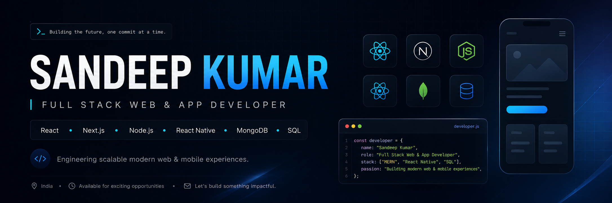

 

  

&nbsp;&nbsp;

&nbsp;&nbsp;

&nbsp;&nbsp;

  

&nbsp;&nbsp;

&nbsp;&nbsp;

---

## 💫 About Me

const sandeep: Developer = {
  name: "Sandeep Kumar",
  role: "Full Stack Web, App & AI Developer",
  location: "India 🇮🇳",
  stack: {
    languages: ["JavaScript", "TypeScript", "Python", "C++", "SQL"],
    frontend: ["React", "Next.js", "React Native", "Expo"],
    backend: ["Node.js", "Express.js", "FastAPI", "WebSockets", "Firebase"],
    ai_workflows: ["LangChain", "LangGraph", "Google Gemini API", "PyMuPDF"],
    database: ["MongoDB", "MySQL", "SQLite", "Firestore"],
    styling: ["TailwindCSS", "NativeWind", "Framer Motion"],
    devops: ["Docker", "GitHub Actions", "Vercel", "Render", "Netlify"]
  },
  passion: "Engineering scalable web, mobile, and real-time AI applications",
  openToWork: true
};
🎯 What I DoWeb DevelopmentMobile AppsBackend & DatabasesGenerative AIModern, responsive websites with React & Next.jsCross-platform apps with React Native & ExpoReal-time APIs & schemas with Node.js, Express, FastAPI, MongoDB & MySQLMulti-agent workflows, PDF parsing & structured LLM pipelines🛠️ Tech Stack💻 Languages🎨 Frontend🎨 Styling & UI⚙️ Backend & AI🗄️ Databases🚀 DevOps & Tools📊 GitHub Analytics📈 Contribution Activity🐍 Contribution Snake🚀 Featured Projects💼 What I'm Working OnYAMLcurrent_focus:
  projects:
    - name: "Concall Pulse — Earnings Signal Pipeline"
      stack: ["Python", "FastAPI", "PyMuPDF", "Google Gemini", "WebSockets", "SQLite"]
      highlights:
        - Real-time NSE/BSE corporate filing ingestion & deduplication
        - Multi-column PDF transcript extraction & Pydantic-grounded AI summaries
        - Live WebSocket streaming to an interactive analyst dashboard

    - name: "LockedIn — Event & Reminder App"
      stack: ["React Native", "Expo", "Firebase", "TypeScript"]
      highlights:
        - User authentication with Firebase
        - Real-time event sync with Firestore
        - Scheduled push notification reminders

  exploring:
    - Real-time distributed event streaming
    - Multi-agent LLM evaluation & grounding
    - System Design & scalable backend architecture
📫 Let's Connect💬 "Code is like humor. When you have to explain it, it's bad."
